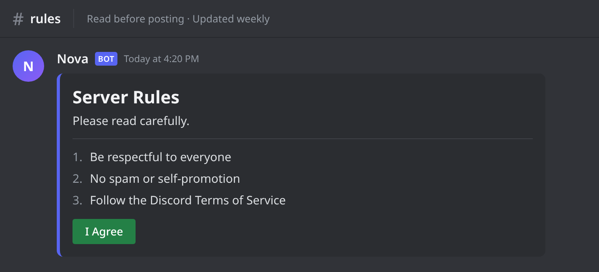
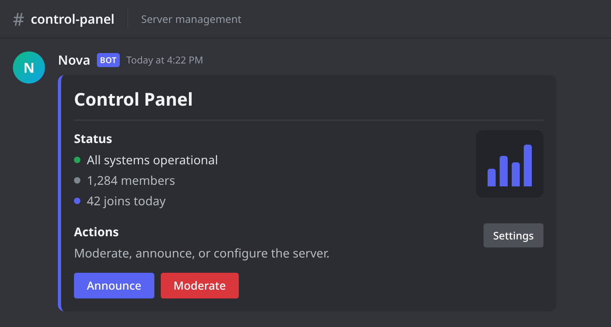
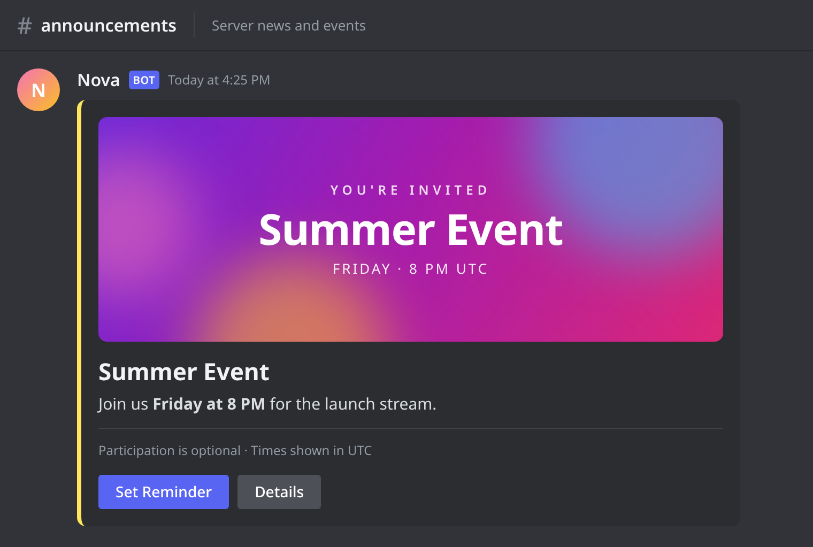

# Discord Components V2 — Agent Skill

[](https://discord.js.org)
[](LICENSE)

An agent skill that teaches AI coding assistants to build polished Discord bot messages with **Components V2** in discord.js — containers, sections, text displays, separators, media galleries, and interactive components — instead of classic embeds.

Works with Claude Code, Cursor, Codex, and any agent that supports the [Agent Skills](https://skills.sh) format.

## Install

```bash
npx skills add Dqrshan/discord-components-v2-skill
```

Or install it directly with the bundled script:

```bash
git clone https://github.com/Dqrshan/discord-components-v2-skill.git
cd discord-components-v2-skill

./install.sh                    # project:  .agents/skills/discord-components-v2
./install.sh -t claude-code -g  # global:   ~/.claude/skills/discord-components-v2
./install.sh -t cursor -g       # global:   ~/.cursor/skills/discord-components-v2
./install.sh --help             # all options
```

`install.sh` also supports `--dir <path>`, `--dry-run`, `--force`, and `--uninstall`.

## Preview

Mockups of messages built with the layouts in this skill.







## What it does

Once installed, the skill activates when you work on Discord bot messages: layouts, buttons, select menus, media galleries, or any request for a "modern", "clean", or "beautiful" Discord message. It covers:

- **The V2 flag** and the rules that come with it — no `content`, `embeds`, `poll`, or `stickers` once `IsComponentsV2` is set.
- **Component limits** — 40 components, 4,000 characters of text, 10 gallery items, one accessory per section.
- **Every builder** — text displays, containers, sections, separators, media galleries, files, and the full button and select API.
- **Layout recipes** — info cards, dashboards, announcements, confirmation prompts, menus, ephemeral success and error states.
- **Migration** — converting existing embed code to containers and text displays, with a field-by-field mapping.
- **Troubleshooting** — fixes for the common runtime errors and payload rejections.
- **Design engineering** — task-first hierarchy, component selection, spacing, color, mobile scanning, accessibility, interaction states, and prompt feedback tailored to Discord's native rendering constraints.

## Example

```js
const { ContainerBuilder, TextDisplayBuilder, SeparatorBuilder, SeparatorSpacingSize,
        ActionRowBuilder, ButtonBuilder, ButtonStyle, MessageFlags } = require('discord.js');

await channel.send({
  flags: MessageFlags.IsComponentsV2,
  components: [
    new ContainerBuilder()
      .setAccentColor(0x5865F2)
      .addTextDisplayComponents(new TextDisplayBuilder().setContent('# Server Rules\nPlease read carefully.'))
      .addSeparatorComponents(new SeparatorBuilder().setDivider(true).setSpacing(SeparatorSpacingSize.Small))
      .addTextDisplayComponents(new TextDisplayBuilder().setContent('1. Be respectful\n2. No spam'))
      .addActionRowComponents(
        new ActionRowBuilder().addComponents(
          new ButtonBuilder().setCustomId('rules:accept').setLabel('I Agree').setStyle(ButtonStyle.Success),
        ),
      ),
  ],
});
```

## Contents

```
SKILL.md                  The whole skill: rules, limits, builders, recipes,
                          migration, troubleshooting, checklist
install.sh                Installer for common agent skill directories
examples/                 Mockup screenshots used in this README
  info-card.png
  dashboard.png
  announcement.png
```

`SKILL.md` is self-contained — it references no other files, so the installed skill is a single file.

## Requirements

- discord.js **≥ 14.19** in the bot project (V2 builders do not exist in earlier versions).
- Node.js 22+ if you install through the `skills` CLI.

## Contributing

Issues and pull requests are welcome. Keep `SKILL.md` self-contained so the installed skill stays a single file.

## License

[MIT](LICENSE) © Darshan
